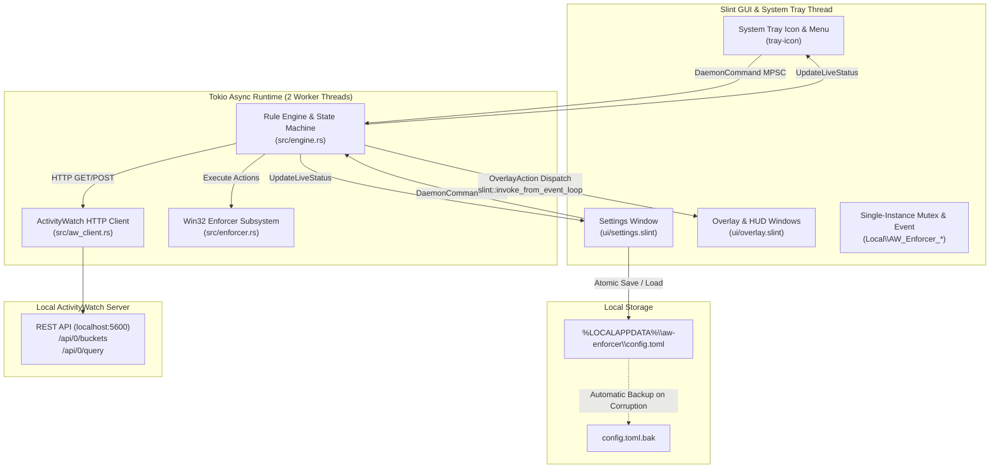
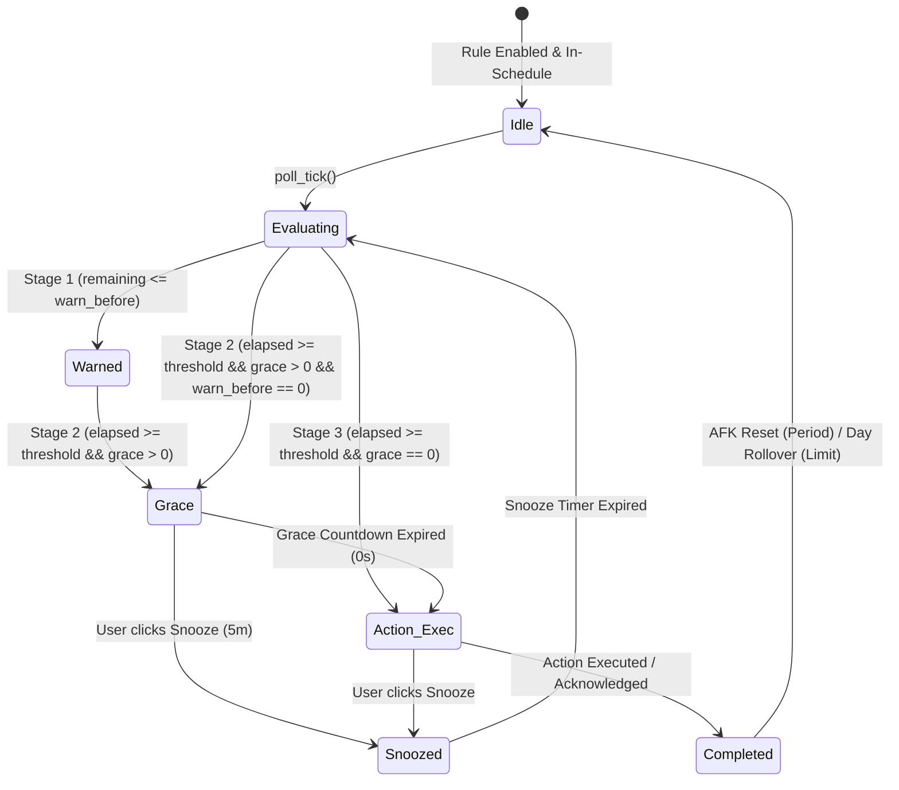
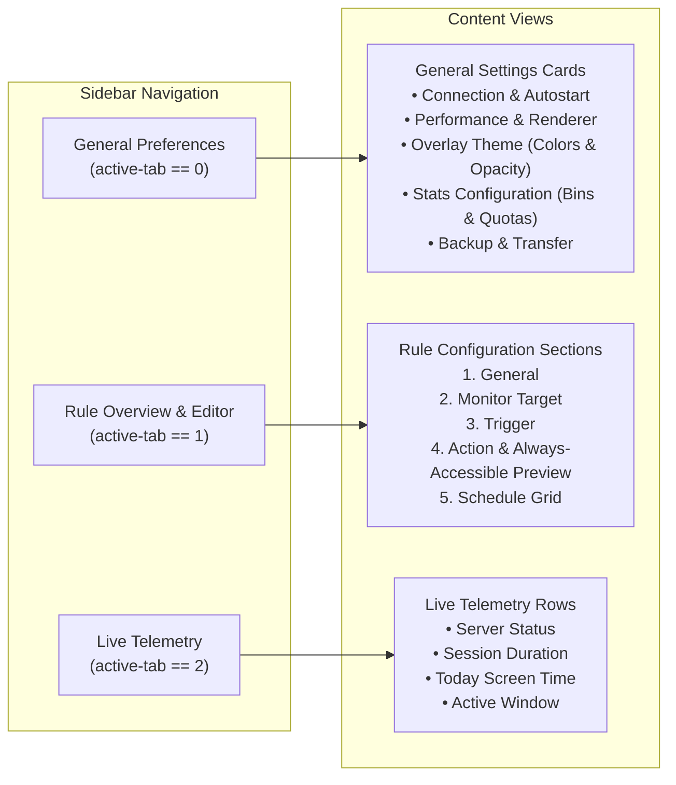

# Technical Specification: AW-Enforcer

| Metadata | Details |
| :--- | :--- |
| **Document Title** | Technical Specification: AW-Enforcer (Unified Rule Engine & Slint UI) |
| **Document Status** | Approved / Living Specification |
| **Target Platform** | Windows 10 / Windows 11 (x86_64) |
| **Implementation Language** | Rust (Edition 2021), Slint UI Toolkit (v1.8+) |
| **Primary Dependency** | Local ActivityWatch Server (`http://localhost:5600/api/0/`) |
| **Last Updated** | November 2026 |

---

## 1. Executive Summary & Problem Statement

### 1.1 Executive Summary
**AW-Enforcer** is a high-performance, lightweight Windows desktop application written in Rust that operates continuously in the system tray. It interfaces with a local [ActivityWatch](https://activitywatch.net/) instance to enforce ergonomic breaks, application time limits, and digital wellbeing policies. Designed with an orthogonal trigger/action architecture, AW-Enforcer supports versatile rule formulations ranging from posture and stretch reminders to strict, un-bypassable process termination and multi-monitor screen lockouts.

### 1.2 Problem Statement
Modern computer professionals face persistent physical and mental fatigue due to prolonged, uninterrupted screen time. While passive tracking tools (such as standard ActivityWatch dashboards) record user behavior, they fail to enforce healthy habits actively. Existing intervention tools suffer from major drawbacks:
1. **Rigid Triggers and Actions:** Time-limit and periodic reminder tools are often hardcoded to specific alerts, lacking support for custom actions (e.g., locking the workstation or terminating distracting processes after a grace period).
2. **Double-Counting and Multi-Monitor Inaccuracies:** Browser extensions continue reporting active tabs even when browser windows are unfocused or idling on a secondary display, skewing time tracking.
3. **Trivial Bypassability:** Users easily close or ignore standard notification prompts during deep distraction or hyperfocus, undermining ergonomic goals.
4. **Heavy Resource Footprint:** Many commercial productivity enforcers rely on bloated Electron runtimes, consuming hundreds of megabytes of RAM and keeping discrete GPUs awake.

AW-Enforcer addresses these challenges through a zero-bloat native architecture, strict Win32 anti-bypass protections, sub-second input-idle detection, and authoritative multi-monitor overlay management.

---

## 2. System Goals and Non-Goals

### 2.1 Functional Goals
- **Orthogonal Rule Configuration:** Any trigger mechanism (`Period` or `Limit`) can be combined with any supported action (`Show Overlay`, `Show Notification`, `Show Statistics`, `Lock Workstation`, `Close Tab`, `Close Window`, `Kill Process`).
- **Three-Stage Enforcement Pipeline:** Every rule supports configurable pre-action warnings (Stage 1), interactive grace countdowns (Stage 2), and authoritative action execution (Stage 3).
- **Accurate Telemetry Aggregation:** Filter and coalesce web events (`aw-watcher-web`) against active foreground browser intervals (`aw-watcher-window`) and idle intervals (`aw-watcher-afk`) without double-counting.
- **Strict Anti-Bypass Enforcements:** Optional strict modes that hide skip/snooze options, lock application settings, and disable tray bypasses across break and grace intervals.
- **Low-Latency Native UI:** A responsive Slint-based GUI that opens instantly, supports hardware-accelerated OpenGL or software rendering, and releases GPU swapchains when dismissed.

### 2.2 Non-Functional Goals
- **Minimal Resource Footprint:** Idle RAM usage below 35 MB, resting CPU usage near 0%, and Tokio runtime constrained to two worker threads.
- **Robust Persistence & Safety:** Atomic configuration saves using temporary sibling files, automatic corrupted file backups (`.toml.bak`), and strict validation clamping.
- **Display Server Resilience:** Graceful handling of display resolution changes, multi-monitor docking/undocking, and fullscreen DirectX/presentation mode detection.

### 2.3 Explicit Non-Goals
- **Cross-Platform Host Support:** AW-Enforcer is purpose-built for the Win32 API ecosystem (Windows 10/11); cross-platform desktop abstractions for macOS/Linux are out of scope.
- **Remote Cloud Sync:** Configuration and telemetry remain strictly local; no external network traffic is generated beyond `localhost` HTTP polling.
- **Kernel-Level Anti-Tamper:** AW-Enforcer operates in user space and does not employ kernel drivers to prevent administrative task termination via Task Manager.

---

## 3. High-Level Architecture & Concurrency Model

### 3.1 Architectural Decomposition

The application is structured into decoupled subsystems operating across distinct threads:



### 3.2 Threading & Communication
1. **Slint Event Loop (Main Thread):** Owns window handles, OpenGL/FemtoVG render contexts, and the Win32 message pump for the system tray. It periodically polls for activation events via a 250ms timer.
2. **Tokio Async Engine Runtime (Background):** A 2-worker multithreaded Tokio runtime driving periodic polling ticks (`poll_interval_seconds`) and a 1-second high-resolution `realtime_tick()` timer.
3. **MPSC Command Channel:** User interactions in the GUI or tray dispatch `DaemonCommand` messages to the engine through a non-blocking Tokio MPSC channel (`tokio::sync::mpsc::Sender<DaemonCommand>`).
4. **UI Dispatch Pipeline:** The engine communicates state changes back to the UI via `slint::invoke_from_event_loop` using typed `OverlayAction` variants, preventing UI freezes during network I/O or Win32 process scans.

---

## 4. Configuration Schema & Data Model (`src/config.rs`)

Configuration resides at `%LOCALAPPDATA%\aw-enforcer\config.toml`. All changes are serialized atomically to prevent corruption.

### 4.1 Type Definitions

```rust
#[derive(Debug, Clone, Copy, PartialEq, Eq, Serialize, Deserialize, Default)]
pub enum TimeUnit {
    Hr,
    #[default]
    Min,
    Sec,
}

#[derive(Debug, Clone, Copy, PartialEq, Eq, Serialize, Deserialize)]
pub struct DurationConfig {
    pub value: u32,
    pub unit: TimeUnit,
}

#[derive(Debug, Clone, Copy, PartialEq, Eq, Default, Serialize, Deserialize)]
pub enum MonitorSelection {
    #[default]
    Executables,
    Titles,
    Urls,
}

#[derive(Debug, Clone, Copy, PartialEq, Eq, Default, Serialize, Deserialize)]
pub enum TriggerType {
    #[default]
    Period,
    Limit,
}

#[derive(Debug, Clone, Copy, PartialEq, Eq, Default, Serialize, Deserialize)]
pub enum RuleAction {
    #[default]
    #[serde(rename = "Show Overlay")]
    ShowOverlay,
    #[serde(rename = "Show Notification")]
    ShowNotification,
    #[serde(rename = "Show Statistics")]
    ShowStatistics,
    #[serde(rename = "Lock Workstation")]
    LockWorkstation,
    #[serde(rename = "Close Tab")]
    CloseTab,
    #[serde(rename = "Close Window")]
    CloseWindow,
    #[serde(rename = "Kill Process")]
    KillProcess,
}

#[derive(Debug, Clone, Copy, PartialEq, Eq, Default, Serialize, Deserialize)]
pub enum NotificationMethod {
    #[default]
    #[serde(rename = "HUD")]
    Hud,
    Windows,
}
```

### 4.2 Complete Rule Structure

```rust
#[derive(Debug, Clone, Serialize, Deserialize)]
pub struct Rule {
    // 1. General
    pub id: String,
    pub enabled: bool,
    pub name: String,

    // 2. Monitor Target
    #[serde(default)]
    pub monitor_selection: MonitorSelection,
    #[serde(default = "default_wildcard_targets")]
    pub target_executables: Vec<String>,     // Wildcard ["*"] or list of .exe names
    #[serde(default)]
    pub title_regex: String,                 // Evaluated when monitor_selection == Titles
    #[serde(default)]
    pub url_regex: String,                   // Evaluated when monitor_selection == Urls

    // 3. Trigger
    #[serde(default)]
    pub trigger: TriggerType,                // Period vs. Limit
    #[serde(default = "default_period")]
    pub period: DurationConfig,              // Continuous active session duration
    #[serde(default = "default_reset_after_afk")]
    pub reset_after_afk: DurationConfig,     // Inactivity duration resetting continuous session
    #[serde(default = "default_limit")]
    pub limit: DurationConfig,               // Cumulative daily screen-time limit

    // 4. Action & Alerts
    #[serde(default)]
    pub action: RuleAction,
    #[serde(default = "default_warn_before")]
    pub warn_before: DurationConfig,         // Stage 1 warning lead time (0 = disabled)
    #[serde(default = "default_grace")]
    pub grace_duration: DurationConfig,      // Stage 2 grace countdown (0 = disabled)
    #[serde(default = "default_break_duration")]
    pub break_duration: DurationConfig,      // Required idle break time for ShowOverlay
    #[serde(default)]
    pub click_through: bool,                 // Passes input through overlay (WS_EX_TRANSPARENT)
    #[serde(default)]
    pub strict_mode: bool,                   // Locks settings and UI during enforcement across all actions
    #[serde(default)]
    pub notification_method: NotificationMethod, // HUD Toast vs. Windows System Toast
    #[serde(default = "default_notification_duration")]
    pub notification_duration: DurationConfig,
    #[serde(default)]
    pub show_remaining_time: bool,           // Real-time HUD countdown display
    #[serde(default)]
    pub message: String,                     // Formatted markdown/color template

    // 5. Schedule
    #[serde(default)]
    pub schedule: RuleSchedule,              // 7x24 bitmask matrix
}
```

### 4.3 Sanitization Invariants & Clamping
Both `Config::load_from_path` and `Config::save_to_path` execute `Config::sanitize(&mut self)` to enforce system stability:
- **Port Clamping:** `aw_port` clamped to valid TCP ports (`1..=65535`).
- **Polling Rate:** `poll_interval_seconds` clamped to `2..=120` seconds.
- **Logical Day-Start:** `day_start_hour` clamped to `0..=23` (default `4` = 04:00 AM).
- **Destructive Action Safety:** `RuleAction::KillProcess` is downgraded to `RuleAction::CloseWindow` unless `monitor_selection == MonitorSelection::Executables` and at least one specific non-wildcard target is present.
- **Duration Clamping:** Duration parameters are clamped to match UI SpinBox ranges: `period.value`, `reset_after_afk.value`, `break_duration.value`, and `notification_duration.value` to `1..=3600`; `limit.value`, `warn_before.value`, and `grace_duration.value` to `0..=3600`.
- **Target Executables Normalization:** Entries are trimmed of whitespace and empty strings dropped. When at least one specific executable exists, wildcards (`"*"`) and comment sentinels (`"#"`) are removed, and entries are deduplicated case-insensitively while preserving ordering. If no specific executable remains, falls back to `["*"]`.
- **Schedule Bitmask Normalization:** Weekday bitmasks are canonicalized via boolean array roundtrip conversion (`RuleSchedule::from_bool_array(&self.schedule.to_bool_array())`), ensuring each day is represented by exactly 24 `'0'`/`'1'` characters.
- **Unique Rule ID Enforcement:** All rule IDs are tracked in a set during sanitization; empty IDs, runtime test overlay prefixes (`"test_*"`), and duplicates are assigned the next available `rule-{n}` identifier.
- **Color Validation:** `overlay.accent_color`, `overlay.background_color`, and `overlay.text_color` are parsed using `formatter::parse_hex_color`. Invalid hex entries reset to default values (`#3b82f6`, `#0f172a`, `#f8fafc`).
- **Stats Consistency & Histogram Clamping:** `daily_screentime_target_minutes` clamped to `1..=1440`, `threshold_excessive_minutes` clamped to `daily_screentime_target_minutes..=1440`, `histogram_bin_size_minutes` clamped to `1..=1440`, and `histogram_bin_count` clamped to `1..=96`.

### 4.4 Reference `config.toml`

```toml
[general]
aw_port = 5600
poll_interval_seconds = 10
autostart = true
api_key = ""
day_start_hour = 4
suppress_fullscreen_d3d = true
pause_all_rules = false
destroy_windows_on_hide = true
slint_renderer = "femtovg"

[overlay]
opacity = 0.90
theme = "dark"
accent_color = "#3b82f6"
background_color = "#0f172a"
text_color = "#f8fafc"

[stats]
daily_screentime_target_minutes = 480
threshold_excessive_minutes = 600
histogram_bin_size_minutes = 60
histogram_bin_count = 24
histogram_time_format = "%H:%M"

[[rules]]
id = "rule-1"
enabled = true
name = "Ergonomic Break"
monitor_selection = "Executables"
target_executables = ["*"]
title_regex = ""
url_regex = ""
trigger = "Period"
period = { value = 50, unit = "Min" }
reset_after_afk = { value = 5, unit = "Min" }
limit = { value = 8, unit = "Hr" }
action = "Show Overlay"
warn_before = { value = 5, unit = "Min" }
grace_duration = { value = 0, unit = "Sec" }
break_duration = { value = 10, unit = "Min" }
click_through = false
strict_mode = true
notification_method = "HUD"
notification_duration = { value = 10, unit = "Sec" }
show_remaining_time = false
message = "# Time for a Break\n[color=#38bdf8 size=18 bold] Active for {session_duration}.\nPlease step away for {break_time}."

[rules.schedule]
mon = "000000001111111111000000"
tue = "000000001111111111000000"
wed = "000000001111111111000000"
thu = "000000001111111111000000"
fri = "000000001111111111000000"
sat = "000000000000000000000000"
sun = "000000000000000000000000"
```

---

## 5. Unified Rule Evaluation & Enforcement Subsystem

### 5.1 Telemetry Aggregation & Web Intersection
ActivityWatch event streams are processed on each `poll_tick()`:
1. **Bucket Discovery & Selection (`select_best_bucket`):** When multiple local watcher buckets exist, metadata is ranked authoritatively:
   - Buckets with `last_updated` are compared first (`b.last_updated.cmp(&a.last_updated)`).
   - Local machine hostname matching `COMPUTERNAME` (`b.hostname_matches.cmp(&a.hostname_matches)`).
   - Effective timestamp (`b.effective_time.cmp(&a.effective_time)`).
   - Ascending lexicographical key order.
2. **Pre-Poll Verification:** `AwClient::prepare_poll_buckets` checks bucket readiness and re-discovers web buckets every 60 seconds. Offline servers produce empty event vectors immediately, reducing network roundtrips from 3 to 1.
3. **Interval Coalescing (`merge_overlapping_intervals`):** Activity intervals across overlapping windows are merged into contiguous non-overlapping spans.
4. **Web Event Filtering & Empty-Window Clearing:** Raw `aw-watcher-web` events are clipped to overlapping active foreground browser intervals (`filter_web_events_by_active_browser_windows`). When no foreground window events were recorded during the polling window (`all_events.is_empty()`), `web_events` are cleared immediately so background browser events never accumulate screen time while the user is AFK or on the desktop.

### 5.2 Rule Lifecycle State Machine



- **Snooze & State Preservation:** `RuleRuntime::snooze` and global snooze (`DaemonCommand::SnoozeAll`) distinguish between active/pending enforcement cycles (`was_enforcing == true`, where an active break, pending break delay, grace countdown, or rollback-eligible completion is in effect) and already-completed idle rules. When deferring an active enforcement cycle, snooze resets `action_executed_today = false` so that enforcement re-evaluates upon snooze expiration. For already-completed daily `Limit` rules (`action_executed_today == true` and `was_enforcing == false`), `action_executed_today = true` is preserved so global or individual snoozes do not erroneously re-trigger completed daily limits once snooze expires.
- **Aborted Active Breaks:** When an in-progress break (`active_break.is_some()`) is interrupted before full completion (e.g., via `DaemonCommand::SetPauseAll { paused: true }` or the rule transitioning off-schedule), `RuleRuntime::reset_active_timers()` resets `action_executed_today = false` and `can_rollback_completion = false`. This guarantees that interrupted breaks are not permanently recorded as completed for the day, allowing enforcement to re-trigger once unpaused or back on schedule.

### 5.3 Three-Stage Evaluation Pipeline

#### Stage 1: Pre-Action Warning (`warn_before > 0`)
- **Trigger Condition:** `threshold > 0 && warn_secs > 0 && warn_secs < threshold && elapsed >= threshold - warn_secs && elapsed < threshold`.
- **Behavior:** Dispatches a HUD toast or native Windows Action Center notification once per cycle (`rt.warned_current_cycle = true`). Pre-action warnings authoritatively respect the rule's configured `notification_method` (`HUD` vs `Windows`), `notification_duration`, and `show_remaining_time` across all rule actions. For `ShowOverlay`, dispatches a specific upcoming-break warning to distinguish it from the break screen itself.

#### Stage 2: Grace Countdown (`grace_duration > 0`)
- **Trigger Condition:** `elapsed >= threshold`.
- **Behavior:** Initiates `rt.grace_countdown = Some((grace_secs, grace_secs))` and displays `OverlayMode::HudTimer`. Populates `allow_snooze: !rule.strict_mode` and `strict_mode: rule.strict_mode`. When `strict_mode` is enabled, Skip and Snooze controls are completely hidden across all actions, and settings/tray bypasses are locked.
- **Dismissing Destructive Grace Timers:** Clicking "Dismiss" (`AcknowledgeAppWarning`) on a non-strict destructive `HudTimer` (`LockWorkstation`, `CloseTab`, `CloseWindow`, `KillProcess`) hides the banner while allowing `rt.grace_countdown` to continue ticking down in the background to execute the action at 0s (users who want to defer enforcement must click `Snooze (5m)`). On strict rules, `AcknowledgeAppWarning` is rejected whenever active enforcement (`rt.grace_countdown`, `rt.active_break`, or `rt.pending_break_since`) is in effect. However, when a strict rule displays a Stage 1 warning or Stage 3 notification `HudToast` (where `grace_countdown.is_none()`), clicking "OK" (`AcknowledgeAppWarning`) clears `rt.can_rollback_completion` and dismisses the toast. For non-destructive actions (`ShowOverlay`, `ShowNotification`, `ShowStatistics`), dismissing cancels grace and completes the cycle.
- **Destructive Action Clamping & LockWorkstation Protection:** When a daily `Limit` rule with destructive actions (`CloseTab`, `CloseWindow`, `KillProcess`) has already executed once today, subsequent triggers clamp `effective_grace = grace_secs.min(5)` to prevent endless bypasses. For `LockWorkstation` limit rules, repeat execution enforces a 15-second minimum grace countdown (`effective_grace = grace_secs.max(15)`) without clamping to a maximum, guaranteeing users unlocking their workstation at least 15 seconds (or their full configured grace duration if longer) to save work or snooze rather than being caught in an instant lock-loop.
- **Tab Navigation Safety & URL Target Resolution:** URL rules continuously verify that the matching tab title and hostname remain open. If the offending tab was closed or switched away from during grace, the action safely aborts and completes the cycle. Events outside the recency cutoff are strictly discarded for URL rules, preventing stale closed tabs from repopulating target metadata. Unified URL hostname extraction (`extract_url_host`) resolves the effective host for `last_matched_app` and window matching across standard HTTP/HTTPS URLs, uppercase schemes (`HTTPS://`), custom browser protocols (`chrome://`, `edge://`, `brave://`), and local `file://` URIs, stripping user credentials, query strings, and fragment identifiers.
- **Minimization & Background Process Resilience:** Minimizing windows during grace does not bypass enforcement. `Close Window` rules scan visible top-level windows (including minimized taskbar windows). `Kill Process` rules verify running targets via ToolHelp snapshots (`find_matching_process`), terminating minimized or tray-resident processes when grace expires. `Lock Workstation` is never skipped when windows are minimized or desktop is active.

#### Stage 3: Action Execution
- **`Show Overlay`:** Launches fullscreen multi-monitor `OverlayMode::BreakEnforcer`. Waits for a 1.5s natural pause in physical user input before display. When launching delayed breaks after the natural pause, the engine verifies `suppress_fullscreen_d3d && enforcer::is_fullscreen_or_presentation_active()`; if active, fullscreen display is suppressed, the break cycle is completed immediately, and an unobtrusive native Windows Action Center notification is dispatched instead. If input is detected during enforcement, progress pauses and displays an idle warning banner. If an active break is aborted before completion (e.g., via pause or off-schedule transition), `action_executed_today` is reset so the break re-triggers once resumed.
- **`Show Notification`:** Emits `OverlayMode::HudToast` or native WinRT toast notification, marking the cycle complete. When configured for HUD notifications (`NotificationMethod::Hud`), if a higher-priority overlay (`priority() > 2`, i.e., `HudTimer` or `BreakEnforcer`) is currently active on screen, the engine automatically falls back to dispatching a native Windows Action Center notification so critical alerts are never silently dropped.
- **`Show Statistics`:** Opens the interactive 24-hour activity HUD (`OverlayMode::HudStatus`), forwarding `rule.click_through` to permit mouse and keyboard passthrough to underlying desktop applications when enabled.
- **`Lock Workstation`:** Calls `enforcer::lock_workstation()`. Suppresses redundant calls if the user is already AFK, and is never skipped by window minimization during grace countdowns.
- **`Close Tab`:** Sends synthesized `Ctrl+W` (`enforcer::close_active_browser_tab`), releasing modifier keys (`VK_SHIFT`, `VK_LSHIFT`, `VK_RSHIFT`, `VK_MENU`, `VK_LMENU`, `VK_RMENU`) and control keys (`VK_LCONTROL`, `VK_RCONTROL`) beforehand. Strictly requires an active matching foreground window verified via `enforcer::find_matching_foreground_window`, ensuring background browser windows never trigger `Ctrl+W` on non-matching active applications.
- **`Close Window`:** Posts `WM_CLOSE` to matching visible top-level windows (including minimized taskbar windows).
- **`Kill Process`:** Terminates target processes via Win32 process handles (`enforcer::kill_target_processes`), verifying running instances via ToolHelp snapshots (`find_matching_process`) even if minimized or tray-resident, and strictly excluding the `aw-enforcer` PID.

---

## 6. Overlay & User Interface Subsystems

### 6.1 Overlay Window Hierarchy & Priority (`src/overlay.rs`)
Overlays are managed authoritatively across all connected monitors:

$$\text{BreakEnforcer (4)} > \text{HudTimer (3)} > \text{HudToast (2)} > \text{HudStatus (1)} > \text{Hidden (0)}$$

- **HudTimer Urgency Tie-Breaking:** When two `HudTimer` overlays compete for display, their priority is tie-broken authoritatively by urgency: `(strict_mode, is_destructive, std::cmp::Reverse(remaining_seconds))`. Destructive actions (`LockWorkstation`, `CloseTab`, `CloseWindow`, `KillProcess`) and lower remaining times take precedence over non-destructive actions, and strict mode supersedes non-strict countdowns.
- **HudToast Warning Preservation:** Competing `HudToast` notifications preserve strict warnings: a non-strict toast cannot overwrite an active strict toast without snooze options (`snooze_options_minutes.is_empty()`).
- **Multi-Monitor Hotplug Detection:** Work areas and monitor counts are tracked dynamically. Connecting or disconnecting displays triggers an automatic placement refresh preserving active countdowns.
- **DirectX D3D / Presentation Suppression:** When `suppress_fullscreen_d3d` is enabled, `SHQueryUserNotificationState` detects games and presentations, downgrading fullscreen overlays to unobtrusive toasts.
- **Resource Cleanup:** When `destroy_windows_on_hide = true`, dismissing overlays immediately drops Slint window instances, releasing GPU swapchains and framebuffer memory.
- **Dynamic Theming & Sizing:** Opacity, accent color, backdrop color, and text color configured in `OverlayConfig` propagate to all overlay windows across all four modes. In `HudStatus`, histogram bars dynamically expand and shrink (`horizontal-stretch: 1; min-width: 2px`) to accommodate any configured bin count (1..=96) and bin size (1..=1440 min), with dynamic label decimation step `(bin_count / 6).max(1)` ensuring crisp, non-overlapping timeline axis labels.
- **Draggable HUD Overlays:** All non-fullscreen HUD overlay cards (`HudToast`, `HudTimer`, `HudStatus`) incorporate a background non-client drag area (`TouchArea { enabled: !root.click-through; mouse-cursor: root.click-through ? default : move; }`) invoking `win.drag-status-window()` on left-click drag. Message bodies in `HudToast` and `HudTimer` use clipped non-flickable containers (`clip: true; vertical-stretch: 1;`) instead of `ScrollView` so no internal flick gesture handler intercepts pointer events, allowing the entire card surface (outside interactive footer buttons and controls) to respond to drag gestures when `!click_through`.
- **Rich Text & Underline Rendering (`ui/formatted_text.slint`, `src/formatter.rs`):** Rich text paragraphs render custom sizes, weights, and colors. Underline rectangles are alignment-aware and dynamically sized to the rendered text content (`width: Math.min(txt.preferred-width, parent.width)`), aligned to the left, center, or right matching paragraph text alignment, and omitted for empty/non-breaking space spacer lines. Preview message contexts (`build_preview_context`) interpolate `{remaining}` using the rule's configured grace duration when `warn_before == 0`, and provide cross-trigger fallbacks for `{limit}` and `{session_duration}`.
- **Statistics Overlay Preemption Guarding:** `Engine::display_stats_overlay` verifies that `HudStatus` took ownership of `active_overlay_mode` immediately after dispatching the initial loading state and again following asynchronous ActivityWatch queries. If a higher-priority overlay (`BreakEnforcer`, `HudTimer`, `HudToast`) is active or preempts `HudStatus` during network operations, `display_stats_overlay` terminates immediately without executing redundant interval queries, populating `stats_cache`, or clobbering active enforcement overlays.

### 6.2 Settings Window Architecture (`ui/settings.slint`, `src/main.rs`)
- **Action & Delivery Channel Polish:** Section 2 automatically resets `Kill Process` to `Close Window` whenever the selection mode switches away from `Executables`. Section 4 exposes `Notification Method`, `Duration`, and `Show Time Remaining` controls whenever `warn_before > 0` or `action == Show Notification`, allowing full customization of Stage 1 pre-action warnings across all rule types.
- **Pattern Validation for Titles & URLs:** Rules with `Titles` or `Urls` monitor selections strictly require non-empty, valid regular expressions. Empty or whitespace-only patterns are rejected with an inline error message ("Title regex pattern cannot be empty" or "URL regex pattern cannot be empty") and prevent saving until resolved. When `Executables` monitoring is selected, regular expression validation is marked valid and bypassed.
- **Visual Feedback & Editor Layout:** In General Settings (Tab 0), interactive 24×24px color swatches provide instant visual feedback alongside Hex color inputs. In the Message Template editor, the container height dynamically expands (`Math.max(120px, message_lines.length * 20px + 14px)`) to accommodate templates with more than 5 lines without gutter clipping.



- **Strict Mode Lock:** While a strict break, grace period, or pending break is active across any rule action, all rule modification callbacks (`on_add_rule`, `on_delete_rule`, `on_active_rule_edited`, etc.) return early, and the UI displays a 15-second unlock countdown card. All General Settings inputs across Tab 0 are disabled (`enabled: !root.ui-locked-by-strict`), and per-rule `"Snooze 15m"` (`!ui-locked-by-strict && enabled && !strict-mode`) and `"Reset Timer"` (`!strict-lock-active && enabled`) action buttons reflect rule enablement and strict-mode invariants across both the Rules Overview and Rule Editor.
- **Real-Time Regex & Strftime Validation:** Syntax errors in title/URL regexes or strftime formats are displayed in an inline warning banner, disabling the `Save & Apply Changes` button.
- **Always-Accessible Rule Preview & Real-Time Countdowns:** The `"Preview This Rule's Alert"` action button is elevated to the root of the Action section card (`SectionCard`), allowing one-click preview verification for all actions (including `Show Statistics` and immediate-action rules without warnings or grace periods). Preview countdown timers (`test_preview`) tick down every second in real time and automatically hide at 0s, while keeping immediate dismissal accessible on the preview card.
- **Click-Through Support on Overlays & Statistics:** The `"Click-through Overlay:"` setting is exposed in Section 4 for both `Show Overlay` and `Show Statistics`, forwarding `rule.click_through` to Slint overlays and Win32 extended window styles (`WS_EX_TRANSPARENT`).
- **Exposed Overlay & Histogram Properties:** General settings expose Hex color pickers (`accent_color`, `background_color`, `text_color`) and histogram discretization controls (`histogram_bin_size_minutes` [1–1440], `histogram_bin_count` [1–96]), clamped safely in `Config::sanitize()`.
- **Global Session Telemetry & Limit Rules:** Live Status (Tab 2) and system tray tooltip session telemetry track the user's overall continuous active screen time via `calculate_continuous_session_from_merged` across all merged ActivityWatch intervals (`merged_all_intervals`), ensuring session duration is reported accurately even when the user only has daily `Limit` rules or app-specific rules configured, and snoozed `Period` rules continue updating `current_session_seconds` for telemetry.

---

## 7. Security, Anti-Bypass & Reliability Architecture

| Subsystem | Mechanism | Technical Implementation |
| :--- | :--- | :--- |
| **Single-Instance Enforcement** | Win32 Named Mutex & Event | `CreateMutexW(..., "Local\\AW_Enforcer_SingleInstance_Mutex")` + `CreateEventW(..., "Local\\AW_Enforcer_Activate_Event")`. Second launches restore existing window and exit. |
| **Shell & Self Protection** | Protected Window & Process Guards | `enforcer::is_protected_window_base` and `is_protected_foreground_window` exclude current PID and shell classes (`Progman`, `WorkerW`, `Shell_TrayWnd`, `MultitaskingViewFrame`) from window closing and process termination, while allowing `Close Window` to match visible top-level windows minimized to the taskbar. |
| **Strict Mode Lockout** | Command & UI Interception | Blocks `SnoozeBreak`, `SkipBreak`, `DismissBreakOverlay`, `SnoozeAll`, `SetPauseAll`, `ResetRuleSession`, and tray bypasses when `rt.active_break`, `rt.grace_countdown`, or `rt.pending_break_since` is active for any rule with `strict_mode == true`. |
| **Atomic Configuration Writes** | Two-Phase Disk Commit | Writes to `config.toml.tmp` and renames to `config.toml`. Corrupted files are preserved to `config.toml.bak` on load failure. |
| **Deduplicated Tab-Closing** | Explicit Win32 Key Synthesis | Clears general and physical left/right modifier state (`VK_SHIFT`, `VK_LSHIFT`, `VK_RSHIFT`, `VK_MENU`, `VK_LMENU`, `VK_RMENU`) prior to dispatching `Ctrl+W` to avoid accidental `Ctrl+Shift+W` (entire window closure). |
| **Poisoned Mutex Recovery** | Safe Lock Unwrapping | All synchronization locks use `.unwrap_or_else(|e| e.into_inner())` to prevent daemon panics if an internal thread panics. |

---

## 8. Performance & Resource Budgets

| Metric | Target Budget | Observed / Measured Implementation |
| :--- | :--- | :--- |
| **Resident Working Set (Idle)** | $< 45\text{ MB}$ | $\sim 28\text{ MB} - 35\text{ MB}$ (with FemtoVG OpenGL backend) |
| **Idle CPU Utilization** | $< 0.2\%$ | $0.0\% - 0.1\%$ between 10-second polling ticks |
| **Thread Count** | $\le 6\text{ OS Threads}$ | Main Slint GUI Thread + 2 Tokio Workers + 1 Helper Pool Thread |
| **Offline Network Overhead** | 1 HTTP Request / tick | Pre-poll bucket verification eliminates query flooding when server is down |
| **Window Scanning Overhead** | $< 1.5\text{ ms} / \text{scan}$ | Zero-allocation UTF-16 shell checks + per-pass `pid_cache`. Lazy window scanning skips Win32 `EnumWindows` scans entirely during `evaluate_rule` until a rule reaches its Stage 1 warning or Stage 2 trigger threshold. |
| **Histogram Binning Overhead** | $O(N \log N + B)$ | Single-pass interval coalescing merges $N$ telemetry events once via `events_to_merged_intervals` before bin assignment, reducing per-bin computation from $O(B \cdot N \log N)$ to $O(N \log N + B)$. |
| **Interval Intersection** | $O(\log N)$ | `compute_overlap_from_merged_intervals` and `filter_web_events_by_active_browser_windows` use binary search (`partition_point`) on pre-merged sorted interval slices to skip non-overlapping historical spans and break immediately upon exceeding range bounds. |
| **Poll Cycle Interval Reuse** | Single-pass merge | Step 5 of `poll_tick` merges `all_events` into `merged_all_intervals` once, reusing the pre-merged slice for both `total_today_secs` telemetry and `refresh_stats_overlay_from_events` without duplicate sorting or allocation. |
| **Global Session Telemetry** | $O(N)$ interval scan | `calculate_continuous_session_from_merged` walks backward from `now_utc` across pre-merged intervals, calculating continuous active screen time for Live Status and tray tooltip telemetry regardless of whether wildcard `Period` rules are active. |

---

## 9. Verification & Test Plan

The application maintains comprehensive test coverage across all domain components:
- **Interval Arithmetic Tests (`src/engine.rs`):** Tests for `merge_overlapping_intervals`, `compute_overlap_from_merged_intervals`, `compute_coalesced_overlap_seconds`, and `filter_web_events_by_active_browser_windows` ensuring background browser exclusion, binary-searched partition point behavior, and boundary edge cases across large datasets.
- **Rule Lifecycle & State Machine Tests (`src/engine.rs`):** Invariant testing for Stage 1/2/3 triggers, grace countdown rollbacks, snooze timestamps, and strict mode command rejections.
- **Configuration & Sanitization Tests (`src/config.rs`):** Verifies atomic file saves, corrupted file backup creation, TCP port clamping, and color sanitization.
- **Format & String Interpolation Tests (`src/formatter.rs`):** Verifies single-pass template parsing, case-insensitive attribute toggling (including uppercase hex colors), grace-aware preview context interpolation, cross-trigger placeholder fallbacks, and Markdown tag stripping for Windows Action Center toasts.
